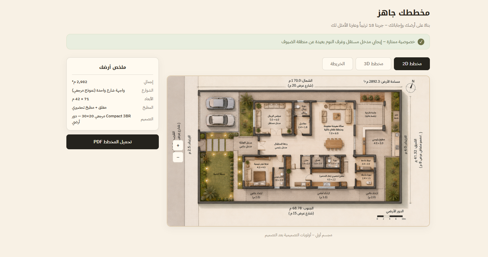
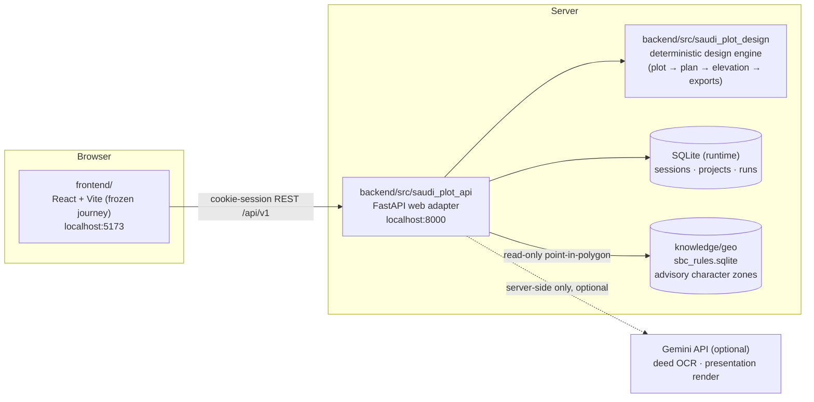

# Saudi Plot Platform

**Private / proprietary — all rights reserved. Not open source. Do not redistribute.**

Saudi Plot Platform turns one rectangular residential plot in Saudi Arabia into a
setback-aware **Compact 3BR** floor-plan skeleton with a Saudi-character front
elevation, delivered through a web journey: deed upload (or manual entry) →
guided questions → deterministic design generation → PDF / DXF / SVG outputs and
an optional AI presentation render.

> **DEMO DISCLAIMER (unconditional).** Every shipped reference dataset —
> geographic zones, architectural character, style rules — is **demo
> provenance**. Nothing in this repository is official Saudi geographic,
> regulatory, or architectural data, and no output is a legal or regulatory
> document. Geographic zone boundaries carry a declared accuracy of about
> **±3 km**. All outputs render this disclaimer unconditionally.

## Screenshots




## Architecture



The dependency direction is one-way: `saudi_plot_api` (web adapter) depends on
`saudi_plot_design` (deterministic core); the core never imports the adapter.
PDF and DXF exports render from the same geometry objects, and the elevation
only draws openings that exist in the floor plan.

## Repository layout

```
backend/            FastAPI adapter + deterministic engine (full git history)
  src/saudi_plot_design/   locked-scope design core (CLI: spd generate)
  src/saudi_plot_api/      web adapter: sessions, projects, runs, renders
  alembic/ …               migrations (python -m saudi_plot_api.migrate)
  tests/                   876-test suite
frontend/           Frozen accepted React journey (full git history)
knowledge/geo/      Versioned advisory geo knowledge package (Git LFS binaries)
docs/               Source versions, architecture overview, demo runbook,
                    export security report
scripts/            Windows PowerShell setup / start / test scripts
.github/workflows/  Backend and frontend CI
```

## Current scope and limitations

- **Demo scope.** The complete journey works end to end for a single
  residential plot; reference generation targets a **20 m × 30 m** plot, and
  other rectangular sizes are handled with explicit, reported assumptions —
  never silently.
- **Compact 3BR only.** The planner produces exactly one program: a compact
  three-bedroom villa skeleton. Other programs, multi-floor layouts, and
  structural/MEP engineering are out of scope.
- The room-program screen validates against this engine limitation and says so
  honestly in its responses.
- Architectural character comes from a point-in-polygon lookup plus **explicit
  user confirmation** — never from an LLM and never from images.
- AI is optional and server-side only (deed OCR and the presentation render);
  without a key, manual entry and deterministic outputs work fully.

## Prerequisites

- Windows (scripts are PowerShell; the code itself is cross-platform)
- Python **3.11+**
- Node.js **20+** with npm
- Git with **Git LFS** (`git lfs install`) — required to check out the
  knowledge databases

## Setup

```powershell
git clone <your-private-remote> saudi-plot-platform
cd saudi-plot-platform
git lfs pull                    # knowledge databases
.\scripts\setup.ps1             # backend venv + deps, frontend npm ci, .env files
```

`setup.ps1` creates `backend/.venv`, installs `backend[dev,web]`, runs
`npm ci` in `frontend/`, and copies both `.env.example` files to `.env` if
they do not exist yet.

## Environment variables

Backend (`backend/.env`, template in `backend/.env.example`):

| Variable | Purpose | Default |
|---|---|---|
| `SPD_ENVIRONMENT` | `development` / `test` / `production` | `development` |
| `SPD_DATABASE_URL` | Runtime DB (SQLite locally) | `sqlite:///./var/saudi_plot_api.db` |
| `SPD_STORAGE_ROOT` | Uploads / generated artifacts | `./var/storage` |
| `SPD_CORS_ORIGINS` | JSON array; never `*` | `["http://localhost:5173"]` |
| `SPD_GEO_KNOWLEDGE_DB` | Advisory character sqlite | `../knowledge/geo/07_database/sbc_rules.sqlite` |
| `GEMINI_API_KEY` | Optional, **server-side only** | empty (AI disabled) |

Frontend (`frontend/.env`, template in `frontend/.env.example`):

| Variable | Purpose | Default |
|---|---|---|
| `VITE_API_BASE_URL` | Backend base URL | `http://localhost:8000` |

No AI provider key ever goes into the frontend environment.

## Running locally

```powershell
.\scripts\start-demo.ps1        # both services, each in its own window
# or individually:
.\scripts\start-backend.ps1     # migrations + uvicorn on :8000
.\scripts\start-frontend.ps1    # vite dev server on :5173
```

| Service | URL |
|---|---|
| Frontend journey | http://localhost:5173 |
| Backend API | http://localhost:8000 |
| API documentation | http://localhost:8000/docs |

## Tests and checks

```powershell
.\scripts\test-backend.ps1      # full pytest suite
.\scripts\build-frontend.ps1    # production build + lint
# manually:
backend\.venv\Scripts\python -m ruff check backend
backend\.venv\Scripts\python -m ruff format --check backend
```

## Privacy warning

Deed documents, extracted deed data, coordinates, and generated designs are
**personal data**. They are stored only in your local runtime database and
storage root (both gitignored) and must never be committed. Share links are
deliberately coordinate-free and expose only sanitized artifacts. If a Gemini
key is configured, uploaded deed images are sent to Google's Gemini API for
extraction — do not configure a key with documents you are not authorized to
process.

## Status and roadmap

**Now (demo-v0.1.0):** first integrated frontend–backend demo — frozen
accepted UI wired to the live backend, deterministic Compact 3BR generation,
advisory geo character lookup, optional AI extraction/render, share links.

**Next:**
- Human review and approval of the 46 pending geo rules and 15 zone conflicts
- Survey-grade control points to tighten the ±3 km geo accuracy
- Approved-case template library integration (M7 track)
- Deployment hardening (PostgreSQL, production cookie/CSRF posture already
  enforced in config)

## License

Private and proprietary. No license is granted. See [SECURITY.md](SECURITY.md)
and [CONTRIBUTING.md](CONTRIBUTING.md).
