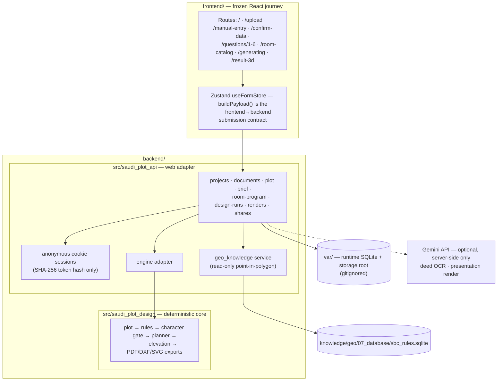

# Architecture Overview

Three layers with a strict one-way dependency direction, plus a versioned
knowledge package:

## Design invariants

- **Dependency direction.** `saudi_plot_api` imports `saudi_plot_design`;
  never the reverse. Enforced by `backend/tests/test_web_dependency_direction.py`.
- **One geometry source.** PDF and DXF render from the same geometry objects;
  exporters never compute geometry.
- **Character gate.** Architectural character comes from point-in-polygon
  lookup plus explicit user confirmation — never an LLM, never images. The
  planner runs only after confirmation.
- **Honest data.** All reference data is demo provenance; loaders reject
  `verified` claims; the DEMO disclaimer renders unconditionally on every
  output. Non-reference inputs produce explicit, reported assumptions.
- **Elevation discipline.** The elevation only draws openings that exist in
  the floor plan; it never adds, removes, or splits them.

## The web journey (backend view)

1. `POST /api/v1/sessions` — anonymous cookie session (HttpOnly, SameSite;
   production refuses insecure settings; Origin/Referer CSRF guard on
   mutations).
2. `POST /api/v1/projects` → project scoped to the session (cross-session
   access is a 404).
3. Deed upload `POST /projects/{id}/documents` — size/MIME limited, stored
   under server-generated names; extraction via Gemini when configured, else
   the structured `extraction_unconfigured` state (manual entry continues).
4. `PUT /projects/{id}/plot | design-brief | room-program` — validated
   persistence; half coordinate pairs are rejected; the room program is
   validated against the Compact 3BR engine limitation with an honest
   engine note.
5. `POST /projects/{id}/resolve-character` — advisory geo lookup (below).
6. `POST /projects/{id}/design-runs` → async run with observable event
   states (`preparing_inputs` … `preparing_outputs`), terminal states, a
   design fingerprint, and explicit assumptions; results expose PDF, DXF,
   plan/elevation SVG, and `run.json`.
7. Optional `POST /design-runs/{id}/presentation-render` — plan SVG is
   rasterized to PNG server-side and sent to the image provider with
   controlled instruction text; failures land in terminal recorded states.
8. `POST /projects/{id}/share` — sanitized share links: no coordinates, no
   deed data, no owner or session identifiers, no filesystem paths.

## Advisory geo knowledge flow

`knowledge/geo/07_database/sbc_rules.sqlite` is opened **read-only**
(`SPD_GEO_KNOWLEDGE_DB`). Lookup replicates the published semantics: bbox
prefilter + shapely containment, city maps over the metropolitan map.
Guidance flows only through fully approved chains (approved zone → approved
link → approved rule). Pending zones/rules stay visible with warnings;
zone-overlap conflicts are reported only when the point lies inside every
conflicting zone, and are never silently resolved. Every response carries the
±3 km accuracy disclaimer; results require user confirmation.

## Storage layout (runtime, gitignored)

- `backend/var/saudi_plot_api.db` — SQLite (sessions, projects, documents,
  runs, shares); PostgreSQL later is a URL change.
- `backend/var/storage/` — uploaded documents and generated artifacts,
  path-traversal-guarded, server-generated names only.
